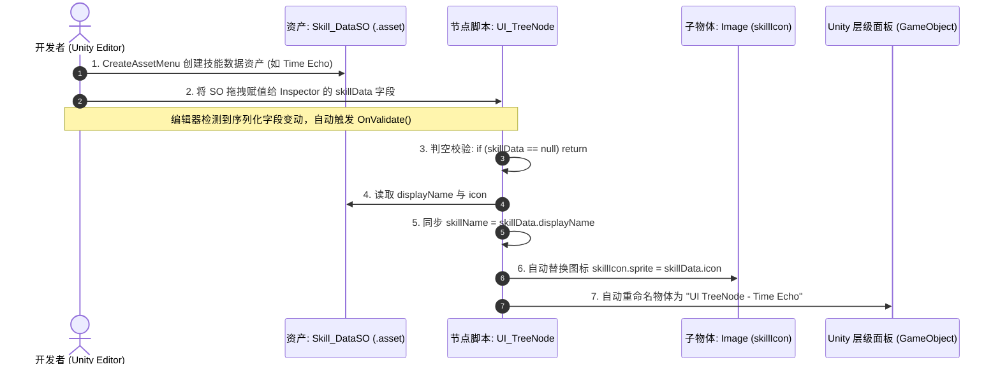
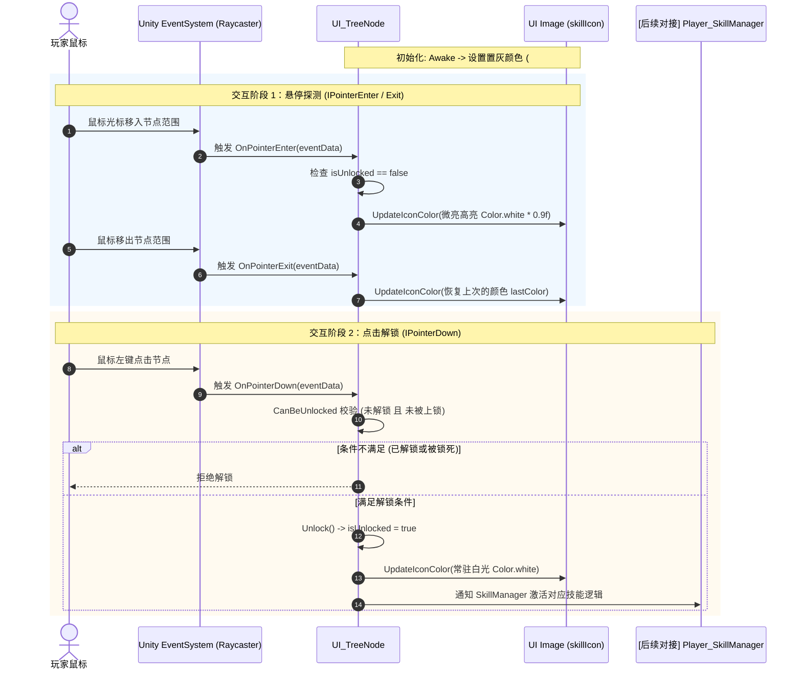
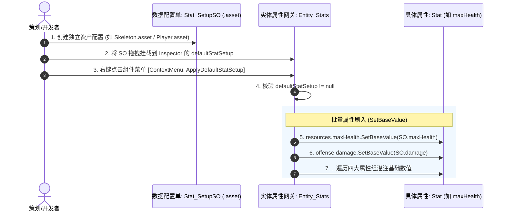
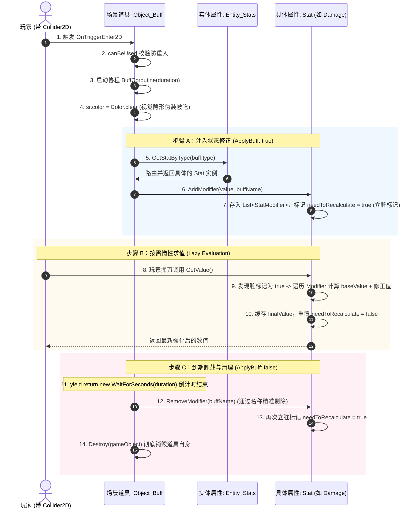
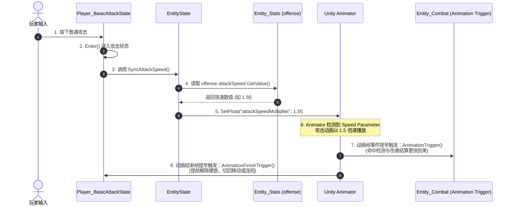
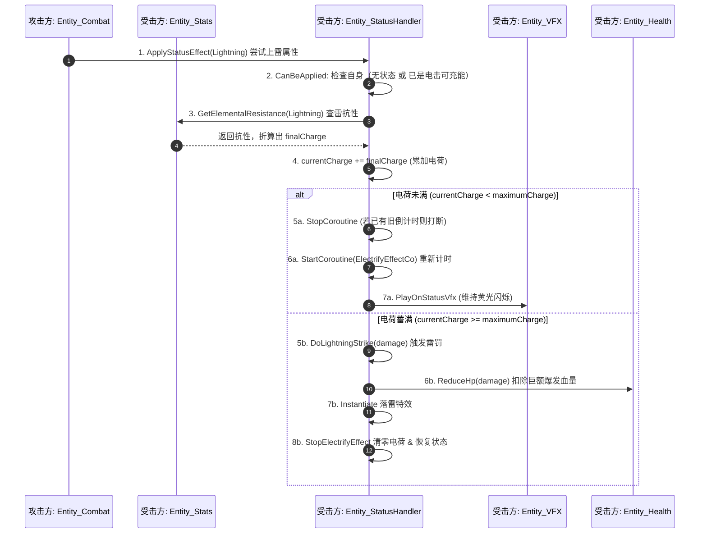

> 本日志持续更新，记录 Unity 2D RPG 项目每节核心机制的**底层设计思想**与**全局因果时序图**（最新进度在最上方）。

---

## 2026-11-25 · 技能数据（Skill_DataSO 与 OnValidate 自动化）

> **核心思想**：用 `OnValidate()` 把数据资产（ScriptableObject）的变更实时投影到编辑器视口中，实现零运行成本的所见即所得（WYSIWYG）工作流。

---

## 2026-11-24 · 技能树节点 UI（UI_TreeNode 与 EventSystems）

> **核心思想**：以状态为核心的视觉驱动（State-Driven Visual），用 `IPointerEnter/Exit/Down` 接口契约替代臃肿的普通 Button 组件。

---

## 2026-11-23 · StatSystem 完结：ScriptableObject 数据驱动预设

> **核心思想**：逻辑写在组件里，数据落在资产（SO）上；用数据驱动代替手动配参，用 `[ContextMenu]` 右键菜单工具提升研发管线效率。

---

## 2026-11-22 · 状态修正系统与可互动增益对象（Stat Modifiers & Object Buff）

> **核心思想**：修饰符列表实现数值可逆，脏标记（Dirty Flag）杜绝重复计算；道具隐身充当计时沙漏，用完自毁不留垃圾。

---

## 2026-11-18 · 生命回复与攻击速度同步（Health Regen & Attack Speed）

> **核心思想**：以动画速度为唯一真理，将手感节奏全权委托给帧事件；只改动画机播放速率，命中判定与收招硬直自然等比例压缩。

---

## 2026-11-18 · 电击状态效果（Electrify / Lightning）

> **核心思想**：连续施压刷新窗口，蓄力爆发一次结清——用协程生命周期管理实现防抖与时间刷新，用累积阈值模式将多次小攻击转化为爆发雷罚。

