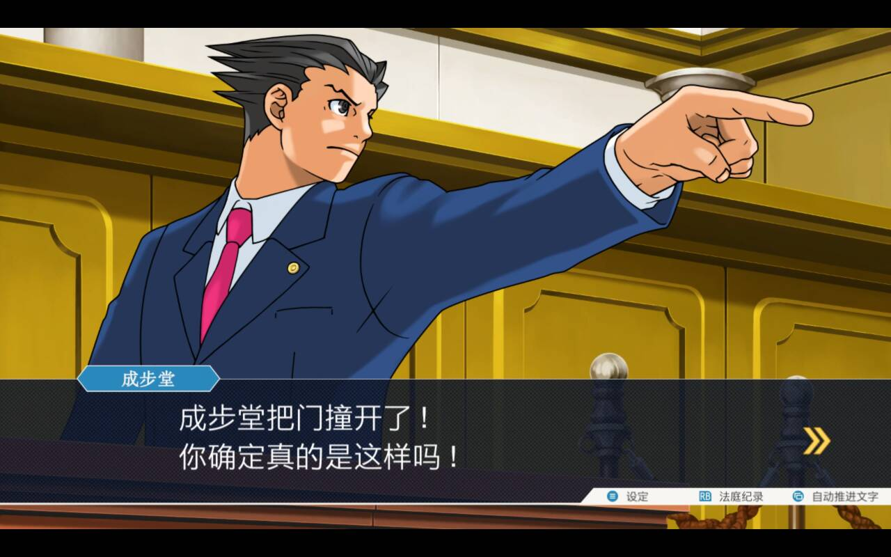
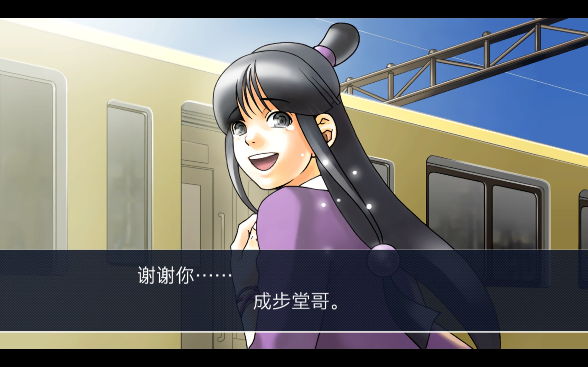

最近在玩逆转裁判：成步堂精选集123，也是久仰大名了，目前刚推完第2部第2章，这个案子有很多槽点，这也是我写下这篇杂谈的动机，本来就是想吐槽的，想了想不如直接写一篇杂谈，多输出一些东西。

---

> **剧透警告**：以下内容含剧透
---

## 剧情概述

先概述一下2-2的内容：一年前，因为护士用错药导致14人死亡的医疗事件，紧接着这个护士却也在之后的一天深夜，和妹妹开车回家的路上，因为疲劳驾驶车祸身亡，妹妹活了下来但是接受了面容上的手术。

这之后这个医院的院长陷入舆论风波，流言说他想把医疗事件的责任推卸给护士并用安眠药造成了车祸，这也造成了医院营收惨淡，因此院长通过护士妹妹的介绍找到了主角成步堂，委托成步堂找到了他之前的助手--绫里真宵，希望她用通灵术召唤出那个身亡的护士写一份承诺书来承认医疗事故和车祸都是自己的原因，和医院、院长无关。

（是的，超自然元素）

事件的过程是密室杀人，在通灵过程中只有施术者和委托人能够在一间房间中，其他人不得入内。在这个过程中院长因为刀伤和枪击身亡。绫里真宵自然成了被告，成步堂当然出任律师。

经过一系列的调查后得出的真相是：杀人者是那个造成医疗事故的护士，她并没有在车祸中丧命，车祸中死去的是她的妹妹，她经过面部的手术整容成了她的妹妹并顶替她的身份一直生活着，但是院长的这个举动会让她的新生活毁灭，于是她联手绫里真宵的母亲的姐姐（真宵的阿姨，下称阿姨），杀害了院长并栽赃给绫里真宵。

### 作案过程

阿姨在布置通灵现场的时候把一个装衣服的箱子放在了一面屏风的后面，凶手即护士提前换上灵媒的服装并躲在里面。待仪式开始之后真宵因安眠药晕倒，凶手趁机出现并用刀捅了院长，之后把真宵藏进箱子，但是院长并未死亡，并用手枪试图反击但是没有打到任何人，凶手接着夺取手枪并射杀院长。

外面的人包括成步堂听到声音后撞门进入现场看到了穿着灵媒服装的凶手并误认为是真宵，随后他们两人被阿姨以报警为由赶走，只剩下两名共犯处理现场。

### 背景补充

绫里家族是一个灵媒的家族，她们家的女性都有着强大的灵力，她们都以通灵为生。通灵时会把亡者的灵魂附在施法者身上，施法者因此会改变形象包括容貌和身材，且通灵过程中施法者没有任何记忆因此真宵认为自己是通灵成功了才没有记忆。

绫里真宵是主家继任的家主，她的母亲是现任家主但是以某些原因依旧失踪。阿姨和她的女儿是所谓的分家，因为身份差距，她们只能服侍主家的人。绫里家的传统是长女继承，但是真宵的妈妈却比阿姨的灵力强大因此成为了家主。阿姨对女儿溺爱且女儿灵力明显强于真宵因此憎恨她。

---

好了，大体经过就是这样，该说不说，内容塞得真多，我已经尽量精简了。接下来终于到了吐槽阶段：

**首先就是**绫里真宵因杀人被指控，就算是她杀人也不是她本身意志的驱使，何况连身材样貌都会改变，游戏世界观中的法律应该也没有完善到这个地步，可以看出来还是以正常世界为基础的。这就是一个值得讨论的问题了，就算是在通灵过程中，护士附身真宵杀人了，到底应不应该给绫里真宵定罪，应该定什么罪？这涉及到伦理？我也不清楚，但是游戏跳过了对这一过程的讨论直接起诉了绫里真宵，我觉得不是一个明智之举。（我希望后续的游玩会打我脸，给我解释一下！！）

**第二**：这是一个推理作品，逻辑是最重要的东西，之前的案件我都觉得可以自洽，但是到了这个案子出现一个重大疏漏。在游戏的证物系统中涉及到了两件凶器：水果刀和手枪，在这两件证物的描述中都出现了有绫里真宵的指纹这样的信息，但是最后的真相是真宵没有触碰过这两件凶器，她在一开始就已经被安眠药迷晕了。游戏也没有解释是不是凶手在作案之后制作的，还是检查官（律师的反方，证明被告有罪）伪造的证据。而且凶器上竟然没有凶手的指纹吗？是警察太无能还是编剧的疏漏呢？

**第三**：最后为什么没有交代共犯也就是阿姨的事情呢？最后阿姨只是作为证人上台撒了个谎就完全没有戏份了，后面都是凶手的自白了。剧情为什么是这样安排的呢？

**最后**，我真想吐槽一下，为什么所有人都在无视法庭，但是只有我（成步堂）会受到惩罚啊喂。虽然这是逆转裁判的老传统了，但是特别是这个案子新出现的检察官，狩魔冥竟然还是狩魔豪的女儿？杀人犯的女儿还可以当检察官吗（狗头），拿鞭子上法庭抽人都来了，什么play吗。还有审判长也是，不要什么人的脸色都看啊。这样怎么当审判长啊。

---

虽然刚玩完一个槽点很多的案子，但是前作的几个案子我还是很喜欢的。特别是1-4和1-5，剧情玩法设计都很不错，有一种沉浸感，一步步探索真相的感觉。

## 玩法与设计

再来说玩法的设计，总体还是文字冒险游戏但在第一部的最后出现了搜查要素，虽然是简单地用试剂探查血迹，用粉末提取指纹，还有用碎片拼出一个证物，甚至还有一段视频作为证物。但我觉得都是很好的创新，既没有破坏游戏的本质，还增加了更多玩法让玩家更有沉浸感。很棒的设计。

还有现在2-2新增的这个心锁的设计，就是现在游戏人物会有一些隐瞒的话需要玩家通过推理和证据来破解心锁，以取得证据。我觉得本质就是为了增加了玩家搜寻证据的难度，和法庭很像。难道很多人说法庭比搜查好玩所以在搜查中加入了法庭的玩法？（狗头）

---

## 总结

作为一个经典的IP，逆转裁判系列到目前为止没有辜负我的期望且在剧情和游戏性上表现优秀（如果之后的案子能质量再高一些并讨论一下我的问题就更好了）。

但也有缺点，信息量很大，一个案件可能牵扯到很多人，之前的案件。在1-4，1-5中就有体现，光是证物就有3、4页，因此需要整段的时间来推一整个案件，如果一个像1-4/1-5这种规模的案件分两天玩，可能第二天打开游戏看到3页证物头都会大。

